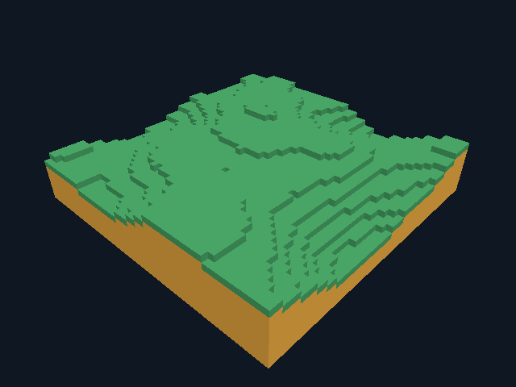

# GooseCraft

Самостоятельный нативный клиент на Goose для Windows 10 x64, разрабатываемый
полностью в Codex Cloud. Цель — реализация поведения Minecraft Java Edition
с отдельным лаунчером. Текущий этап **0.7.0 — измерения игрового цикла**:
девять чанков, холмы в области 48×48, движение и редактирование через границы,
воспроизводимая целочисленная генерация на Goose. Сохранения 0.5 читаются.
Блоки сохраняются по F5 и при штатном выходе, загружаются при следующем запуске.
Greedy meshing, повторное использование GPU-буферов, кеш HUD и прежнее управление
сохранены. Это собственный ограниченный voxel-прототип, пока без сети,
бесконечного мира и совместимости с Java Edition.



## Компоненты

- `goosecraft-client`: окно 640×480, камера игрока, прицел, обводка выбранного
  блока и подсказки управления. Мир, физика, выбор/изменение блоков, геометрия,
  HUD и управление рендерером написаны на Goose. GLSL преобразует вершины и цвет.
- `goosecraft-headless`: независимый консольный тестовый клиент без SDL и GPU.
- `goosecraft.cmd`: Windows-лаунчер. По умолчанию открывает графический клиент;
  с первым аргументом `--headless` запускает headless-клиент и передаёт ему аргументы.
- Python используется только для сборки, проверок и упаковки. Оригинальный
  Minecraft, Horizon и JVM не запускаются. Minecraft-ресурсов в поставке нет.

## Управление

WASD — движение; мышь или стрелки — обзор; Space — прыжок; левая кнопка мыши —
удалить выбранный блок; правая — поставить; 1/2 — зелёный/янтарный материал.
Escape освобождает мышь и ставит игру на паузу, клик или Enter продолжает.
R возвращает на старт; F5 сохраняет блоки; F10 или закрытие окна сохраняет
изменения и завершает игру. Положение игрока не сохраняется.
На Windows файл по умолчанию: `%LOCALAPPDATA%\GooseCraft\worlds\default-v1.gcw`.
`--no-save` создаёт временный сеанс; `--world FILE` задаёт свой путь.
`--seed 0..4294967295` выбирает новый рельеф (по умолчанию 12345),
`--demo-world` — старую площадку со столбиками. Существующие миры не
перегенерируются; явный seed с существующим файлом отвергается.
[Первый запуск на Windows](docs/first-play.md), [формат сохранения](docs/world-format.md).

## Оптимизация и цель проекта

На этапе 0.4 greedy-меш одночанковой сцены уменьшен с 620 до 22 прямоугольников,
полезные vertex/index данные — с 54 560 до 1 936 байт до согласования рёбер.
При неподвижном игроке HUD и обводка загружаются
один раз вместо каждого кадра. [Замеры и ограничения](docs/optimization-1.md)
включают сложные случаи, где мешер строится медленнее. Это сравнение с нашей
предыдущей реализацией; преимущество над Minecraft ещё не измерено.

Цель — эффективный клиент, затем вход на серверы Java Edition.
[План развития](docs/roadmap.md): более крупные миры и профилирование игры,
доставка, затем проверенный протокол конкретной версии. Сейчас сети нет.
В 0.5 обычный взгляд отправляет 5 из 9 чанков в GPU; правка внутри перестраивает
один, на стыке — соседние. [Проверки 0.5](docs/multichunk-results.md).
В 0.6.1 добавлено согласование рёбер greedy-меша: оба выявленных просвета
устранены в облачных проверках. Восемь headless suites и 75 графических
сценариев проверяют геометрию, стыки, четыре seed и четыре ракурса.
Геометрии стало больше, чем в 0.6, но её всё ещё в 3,7 раза меньше, чем
у эталона из единичных граней; CPU-построение стало медленнее.
[Замеры, ограничения и проверки 0.6.1](docs/stitch-results.md).
В 0.7 добавлен профиль на Goose: p50/p95/p99 wall time, стадии, remesh,
draw calls, uploads и известные ёмкости буферов. `--profile run-001.json`
выгружает последние 1024 samples при выходе. Девять headless suites и
84 графических сценария; [как читать профиль](docs/profiling.md),
[реальные замеры и границы выводов](docs/profiling-results.md).
Обычный выход без screenshot больше не читает пиксели из GPU.

## Проверки в облаке

Пользователю пока ничего не требуется устанавливать на Windows.
На существующем облачном x64-хосте с Git, Python, make и C/C++20-компилятором:

```sh
python3 -m venv .venv
.venv/bin/python -m pip install -r tools/requirements.txt
.venv/bin/python tools/bootstrap.py --jobs 2
.venv/bin/python tools/project.py test
.venv/bin/python tools/project.py benchmark --evidence build/benchmarks
./build/goosecraft-headless --headless --ticks 20
```

```json
{"mode":"headless","ticks":20,"solid_blocks":256}
```

Для графики в облачном Docker:

```sh
docker build --target graphics -f .devcontainer/Dockerfile -t goosecraft-graphics .
mkdir -p graphics-results
docker run --rm --network=none \
  --mount "type=bind,src=$PWD/graphics-results,dst=/results" \
  goosecraft-graphics python tools/project.py render-test --evidence /results
```

Если облако использует дополнительный proxy CA, добавьте к `docker build`
`--secret id=proxy_ca,src=/etc/ssl/certs/ca-certificates.crt`.
Тест использует Mesa lavapipe и Xvfb; физическая видеокарта не требуется.
Обычный Docker build без `--target graphics` сохраняет отдельное headless-окружение.

## Windows-сборки

[Workflow](.github/workflows/build.yml) готовит Windows x64 артефакт с обоими
исполняемыми файлами, лаунчером и лицензиями. Для запуска сборки не нужны
Goose, Python, Java или локальная среда разработки. Ожидаемый вызов лаунчера:
`goosecraft.cmd` для окна, `goosecraft.cmd --headless --ticks 20` для консольной проверки.

Публичный репозиторий: [kokasikhorik-bot/GooseCraft](https://github.com/kokasikhorik-bot/GooseCraft).
Готовые ZIP публикуются в [GitHub Actions](https://github.com/kokasikhorik-bot/GooseCraft/actions/workflows/build.yml).
Предыдущая версия 0.6.1: [успешный CI #41053468183](https://github.com/kokasikhorik-bot/GooseCraft/actions/runs/41053468183),
[Windows ZIP](https://github.com/kokasikhorik-bot/GooseCraft/actions/runs/41053468183/artifacts/12976740022).
Выберите успешный run нужной версии и артефакт `goosecraft-windows-2022-x64-...`.
Поставка содержит `BUILD-INFO.json` с версией, source SHA и ссылкой на её CI.
Подтверждённые результаты и текущая ссылка на Windows ZIP находятся в
[актуальном отчёте](https://github.com/kokasikhorik-bot/GooseCraft/blob/main/docs/github-ci.md).
Windows GUI и пользовательская Windows 10 ещё не проверены.

## Документация

- [Архитектура и этапы](docs/architecture.md)
- [Аудит компилятора](docs/goose-audit.md)
- [Облачное окружение и графические проверки](docs/cloud.md)
- [Результаты этапа 1](docs/stage-1-results.md)
- [Результаты графического этапа](docs/stage-2-results.md)
- [Игровой цикл и проверки ввода](docs/stage-3-results.md)
- [Оптимизация и benchmark](docs/optimization-1.md)
- [Несколько чанков и сохранение](docs/multichunk-results.md)
- [Рельеф по seed и проверки 0.6](docs/terrain-results.md)
- [Согласование рёбер и стоимость исправления 0.6.1](docs/stitch-results.md)
- [Профиль клиента: запуск и схема](docs/profiling.md)
- [Измерения игрового цикла 0.7](docs/profiling-results.md)
- [Формат сохранения](docs/world-format.md)
- [План до серверов Java Edition](docs/roadmap.md)
- [GitHub и статус CI](docs/github-ci.md)
- [Лицензии](THIRD_PARTY_NOTICES.md)

Проект не является официальным продуктом Minecraft и не связан с Mojang/Microsoft.
