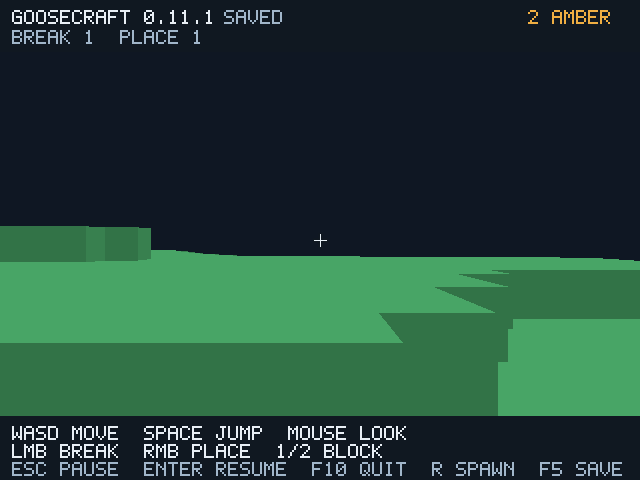

# GooseCraft 0.11.1 — повторное использование preflight

В `--paged-world DIR` кеш из восьми страниц теперь сохраняет не только
результаты Goose worker, но и успешные синхронные preflight-чтения. На том же
файловом replay основной поток вызывает подготовку **30 раз вместо 38 в 0.11**,
а uncached `--sync-paging` — 48 раз. Worker читает ещё пять страниц; всего
35 файловых подготовок вместо 43 в 0.11. Это вызовы helper, не kernel syscalls.
Эти счётчики относятся к игровому циклу; начальная загрузка и импорт/экспорт
в них не входят.



```bat
goosecraft.cmd --paged-world BigPages
goosecraft.cmd --paged-world BigPages --sync-paging
```

Форматы GCW v1/v2, directory v3, генератор 1 и управление не менялись.
Обычный `--world FILE`, startup и `--sync-paging` сохраняют прежний путь.

## Почему это безопасно

До eviction по-прежнему проверяются **все** входящие страницы. Подходящие
worker results сохраняются; освобождаются записи для другой области,
резидентного чанка, неверной подписи или ошибки. Успешный main preflight
занимает только свободный слот, не вытесняя полезный worker result. Во время
admission используется готовый Chunk с проверкой slot/generation/hash/count.
Синхронные попадания считаются отдельно в `fallback_reuses`; прежний
`prefetch_hits` означает только работу worker.

Страницы, не поместившиеся в восемь слотов, читаются повторно по прежнему
safe path. Ошибка preflight или dirty commit оставляет live model целой;
успешные staged pages могут использоваться при повторной попытке. Изменённые
поколения кеша отбрасываются. Внешняя правка файлов во время сеанса по-прежнему
не поддерживается. Если файл изменится между двумя uncached чтениями, путь
остаётся fail closed; это не обещание транзакции при внешнем повреждении.

Политика и Chunk остаются на Goose, `native/fileio.c` не менялся. Новых
зависимостей, API компилятора или сетевого кода нет. Один worker и queue limit 1
сохранены. Staging остаётся восемь страниц: **32976 байт вместо 32968** из-за
восьми bool источника результата. Request 1337, Result 4138 байт. CPU block
pool прежний: 49 слотов/200704 байта. Это payload capacity, не общий RSS.

## Реальные проверки

`python tools/project.py test` прошёл на Linux GCC 14.2 и в pinned Docker GCC
12.2: прежние 12 suites в TinyCC/native release/debug и native-only worker
в release/debug. Отказ TinyCC для TLS потоков проверен, JIT потоков не заявляется.
Новый paging test проверяет холодный край: пять incoming читаются пять раз,
без worker hits. При teleport с 15 incoming staging экономит ровно восемь
чтений. Проверены соответствие блоков генератору, повреждение последней входящей
страницы после заполнения кеша, повторная попытка, ошибка dirty-eviction commit
и устаревшая кешированная generation после редактирования/сохранения.

`render-test` прошёл **128 сценариев Vulkan/Xvfb**, network=none, Linux Mesa
lavapipe CPU. 119 PNG и 38 профилей, independently recomputed percentiles,
misuse=0. Прежние 127 сценариев сохранены; новый файловый сценарий с задержкой
worker проверяет fallback независимо от скорости background. В нём worker hits=0,
fallback reuses=13, main file preparations=35 вместо 48. PNG, gameplay и
GCW export совпали с синхронным и полным CPU backend. Проверки bounded queues,
shutdown, readback, источника импорта и неизменности reopen-сохранения прошли.

[Headless GCC 14](validation/fallback/headless-linux-gcc14.log),
[GCC 12](validation/fallback/headless-linux-gcc12.log),
[графический лог](validation/fallback/render.log),
[итог/PNG hashes](validation/fallback/render-results.json),
[подписи исходников и окружение](validation/fallback/provenance.json).

Упакованный Linux-клиент дополнительно прошёл 680 кадров как UID 1000 из `/tmp`,
network=none, root filesystem read-only, исходный `/work` и Goose compiler скрыты
tmpfs. При искусственно опоздавшем worker: 13 fallback reuses, 0 worker hits,
все задания завершены, misuse=0. PNG совпал с основным delayed replay. Свой
упакованный headless проверил сохранённый каталог; повторная проверка не изменила
index/page hashes. Бинарники совпали с тестовыми, все 12 лицензий сохранены
побайтно, миров и debug-программ в поставке нет. При локальной упаковке владелец
выходного каталога приведён к UID 1000; содержимое binary/license не менялось.
BUILD-INFO: 0.11.1, source `7ff602d`, formats [1,2,3], profiling schema 1.
[Итог поставки](validation/fallback/package-results.json),
[кадр](validation/fallback/package/frame.png),
[raw profile](validation/fallback/package/frames.json).
Это проверка Linux-поставки, не скачанного Windows ZIP.

## Парное сравнение с 0.11.0

Сохранённый native binary source `437bed6` сверён по SHA-256 с проверенной
[Linux-поставкой 0.11](validation/prefetch/package-results.json). Затем обе
версии запущены в одном pinned graphics container, X11/lavapipe, без сети:
по три пары с чередованием порядка для обычного I/O и искусственных 2 мс
на подготовку. Каждый запуск — новый импорт того же seed 12345, 680 кадров,
фиксированный input replay; R в кадре 620. До и после сравнения выполняются
реальные импорт/экспорт своим headless binary. Профили проверены независимо.

| Медиана трёх запусков | 0.11.0 | 0.11.1 |
| --- | ---: | ---: |
| Main подготовки, обычный файл, весь маршрут | 0,7114 мс | 0,5730 мс |
| Game stage кадра R, обычный файл | 0,7249 мс | 0,5892 мс |
| Полный CPU wall кадра R, обычный файл | 2,3255 мс | 2,3733 мс |
| Main подготовки, искусственные 2 мс, весь маршрут | 79,4089 мс | 62,7111 мс |
| Game stage кадра R, искусственные 2 мс | 79,4254 мс | 62,7293 мс |
| Полный CPU wall кадра R, искусственные 2 мс | 81,3286 мс | 64,4955 мс |

Во всех 12 запусках worker hits=5, main calls=38/30; новая версия дополнительно
использовала восемь preflight results. Уменьшение вызовов обусловлено кодом,
времена зависят от окружения. Файлы в обычном сценарии попадают в OS cache;
это не измерение медленного физического диска. Задержка 2 мс искусственная,
не benchmark оборудования и не доказательство FPS-преимущества над Minecraft.
Без задержки полный кадр R **не ускорился**; остаются pump/GPU/driver и mesh.

Блоки, состояние игрока/тики/правки, chunk rebuild counts и GCW export во всех
парах равны. Изображения сравниваются попиксельно за пределами строки версии
HUD: она изменилась с 0.11.0 на 0.11.1. Это ограничение явно проверено скриптом.
[Все пары, binary hashes и медианы](validation/fallback/paired/comparison.json),
[команды и stdout](validation/fallback/comparison.log).

Воспроизведение после `render-test` в закреплённом graphics container:

```sh
python tools/compare_paging.py --baseline /baseline/goosecraft-client \
  --evidence /results/paired --pairs 3
```

`/baseline/goosecraft-client` — сохранённый проверенный 0.11.0 binary с SHA-256
`31f3260d3fc17d72d8cecb1f1c5596a3700d7ecccdd5bb7d8307c23908d58627`;
скрипт проверяет подпись и версии. Нужны новые каталоги evidence и
`build/paging comparison`; данные мира остаются в ignored build, не в Git.

## Что остаётся

Это небольшой этап сокращения повторной работы. Большой переход по R всё ещё
выполняет синхронное чтение на main; начальная загрузка, commit/F5 и fallback
могут задерживать кадр. Физика и меши не используют отсутствующие страницы.
Следующий этап — ограничить работу большого перехода по кадрам с явным
состоянием ожидания данных. Общий FPS, полный RSS/VRAM, физическая видеокарта
и Windows 10 GUI не проверены. Мир конечный, подключения к серверам Minecraft
ещё нет. Итоги Windows сборки публикуются в [отчёте CI](github-ci.md).

Все три jobs [Actions 41095302452](https://github.com/kokasikhorik-bot/GooseCraft/actions/runs/41095302452)
для source `7ff602dddcfe93506134f87305f8a929bea16f22` завершились **success**.
Windows выполнил native/JIT/CLI проверки и собрал release/debug графику;
Linux graphics CI подтвердил 128 сценариев. [Windows ZIP 0.11.1](https://github.com/kokasikhorik-bot/GooseCraft/actions/runs/41095302452/artifacts/12996891028)
создан. Полные API metadata и границы подтверждения сохранены в отчёте CI;
пользовательское окно Windows 10 этим не проверяется.
