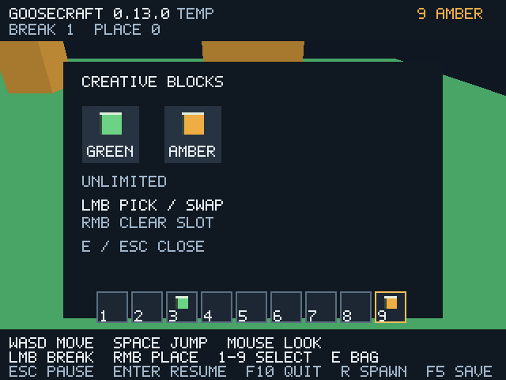

# GooseCraft 0.13 — творческий инвентарь

Обычный запуск `goosecraft.cmd` теперь показывает девять слотов быстрого доступа.
`1–9` выбирают слот, `E` открывает творческую палитру двух существующих материалов.

Левая кнопка берёт материал из палитры, поднимает блок из слота или меняет его
с блоком на курсоре. Правая очищает слот; на палитре — очищает курсор.
E/Escape закрывает окно и сбрасывает held item. Пустой выбранный слот не ставит
блоки. Материалы бесконечны: это творческий инвентарь без стаков, расхода
ресурсов, крафта и предметов-сущностей. Раскладка и выбранный слот действуют
до выхода; новый запуск начинает с green/amber в слотах 1/2. Блоки мира сохраняются
прежним способом. GCW v1/v2, directory v3 и generator 1 не менялись.

## Ввод и безопасность модального окна

При открытии освобождается relative mouse и показывается системный курсор.
Движение/обзор/прыжок/правки мира не выполняются; accumulator и pending jump
сбрасываются. Input UI обрабатывается до физики. Клик одновременно с закрытием
E/Escape не разрушает и не устанавливает блок за окном. После закрытия мышь
снова захватывается. Потеря focus закрывает инвентарь, очищает cursor item
и ставит игру на обычную паузу; Enter/клик возобновляет игру без правки мира.
Во время deferred R инвентарь не открывается.

`src/core/inventory.goose` — чистая Goose-модель: девять IDs, выбранный slot,
opened/held. Она не импортирует gfx/OS. Общие Rect/hit-test используются HUD
и input; GPU/key/window API — только в render. Неверные номера и клики вне
палитры/слотов не меняют состояние. Material 0 проходит через прежний запрет
`interaction::place`, а не превращается в запись air поверх существующего блока.
Новых зависимостей, native/C функций и сторонних ресурсов нет. Иконки и шрифт
строятся собственной геометрией на Goose, уведомления лицензий сохранены.

HUD использует прежний buffer 512 KiB. Cache key включает bag/cursor; pointer
учитывается только при открытом окне, поэтому прежняя проверка одного idle
HUD upload проходит. Новый UI увеличивает рисуемую геометрию; FPS-прирост
от этой игровой функции не заявляется.

## Реальные проверки

**13 suites** прошли TinyCC/native release/debug на GCC 14.2 и в pinned Docker
GCC 12.2; отдельно два native-only worker suites release/debug и отрицательные
TLS JIT probes. Inventory suite проверяет пустой слот, выбор 1–9, неверные
индексы, palette pick, перенос/обмен/очистку, закрытие с item на курсоре,
hit bounds/gaps при ширинах 320/640/1280 и неизменность мира при попытке place
пустым слотом. Форматы/генераторы/строгие byte checks прежних suites сохранены.

**149 Vulkan/Xvfb сценариев** прошли, network=none, pinned Mesa lavapipe CPU:
прежние 139 плюс десять inventory cases. 140 PNG и 58 профилей, misuse=0,
процентили независимо пересчитаны. Проверены empty slot, held cursor, открытое
окно, полный replay, window/debug/release, save/reopen и paged/Map backend.
В двух новых terrain inventory cases взгляд вниз полностью заполняет screen
геометрией/GUI (colored_pixels=307200): upper bound разрешён только для этих
сценариев, PNG сравнивается с независимым Map backend. Save/TEMP HUD различается,
поэтому их PNG не объявлены равными; сохранность данных проверяется отдельно.

Полный input replay на 90 кадров:

- 28 inventory frames и четыре focus-paused frames, **116 ticks**;
- 1 break, 1 place, revision 2, без движения/прыжков и изменения yaw/pitch;
- три открытия, семь полезных кликов UI, три release/recapture мыши;
- пустой слот не ставит блок, вне окна клик не меняет мир;
- одновременные E+RMB и Escape+LMB не передаются в мир;
- hotbar `[0,0,1,0,0,0,0,0,2]`, выбран слот 9/material 2, cursor пуст;
- focus loss и закрытие очищают held item, повторное открытие мира не меняет
  save bytes и возвращает начальную раскладку.

Поза, ticks, yaw/pitch и revision открытого inventory snapshot сравниваются
строго с состоянием до открытия: удержанные W/Space и большие mouse motions
не влияют на игру. PNG полного replay совпали window/offscreen/debug;
состояния и PNG paged/Map совпали, GCW export равен побайтно.

[Итог](validation/inventory/inventory-results.json),
[счётчики и PNG hashes](validation/inventory/render-results.json),
[held cursor](validation/inventory/inventory-held.png),
[закрытое окно/новая раскладка](validation/inventory/inventory-final.png),
[headless GCC 14](validation/inventory/headless-linux-gcc14.log),
[GCC 12](validation/inventory/headless-linux-gcc12.log),
[graphics log](validation/inventory/render.log),
[provenance](validation/inventory/provenance.json).

GUI проверен на Linux software Vulkan/Xvfb с настоящим pinned gfx input API,
инъекцией событий и framebuffer readback; физические устройства и Windows 10
GUI не проверены. Windows build/test delivery — в [отчёте CI](github-ci.md).
Workflow [41103646909](https://github.com/kokasikhorik-bot/GooseCraft/actions/runs/41103646909)
для source `57d22499cca708bc6b8934260106e36188d05486` завершился success;
Windows/Ubuntu native checks и Linux graphics job подтверждены.
[Windows ZIP 0.13](https://github.com/kokasikhorik-bot/GooseCraft/actions/runs/41103646909/artifacts/12998514724)
создан, Windows GUI не открывался.
Сети Java Edition, высокой модели мира и освещения пока нет;
[план следующих функциональных этапов](roadmap.md).

Дополнительная Linux-поставка проверена как UID 1000 из `/tmp`, network=none,
root filesystem read-only, `/work` и Goose compiler скрыты tmpfs. Упакованный
client прошёл полный replay 90 кадров и snapshot 14 кадров с held cursor.
PNG обоих запусков совпали с полным suite; native headless подтвердил 267
блоков/GCW v1, повторный inspection не изменил SHA-256 мира. Бинарники совпали
с тестовыми, 12 лицензий сохранены побайтно, миров/debug binaries в поставке
нет. Локальный владелец каталога приведён к UID 1000 без изменения файлов.
BUILD-INFO: 0.13.0, source `57d2249`, formats [1,2,3]. Это Linux-проверка,
не запуск скачанного Windows ZIP. [Итог](validation/inventory/package-results.json),
[финальный кадр](validation/inventory/package/frame.png),
[held cursor](validation/inventory/package/held.png).
