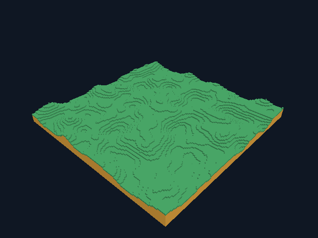

# GooseCraft 0.8 — мир 144×144 на Goose

Новый обычный мир расширен с 9 до **81 чанка**, с 48×48 до **144×144** блоков.
Высота пока 16, собственные материалы 0/1/2. Движение, raycast и редактирование
работают за прежними границами. Это конечный полностью резидентный мир:
потоковой подгрузки, бесконечной генерации и сетевого клиента ещё нет.



## Запуск и сохранение

```bat
goosecraft.cmd --world Big.gcw --radius 4
goosecraft.cmd --no-save --radius 2
goosecraft.cmd --preview --radius 4 --frames 3 --screenshot large.png
goosecraft.cmd --headless --generate-world 12345 BigHeadless.gcw --radius 4
```

`--radius 1..4` выбирает 9/25/49/81 чанк, сторону 48/80/112/144.
Обычный новый сеанс по умолчанию имеет радиус 4. Preview/replay/demo сохраняют
диагностический default 1, если размер не задан; `--single-chunk` — прежний
отдельный режим. `--far-replay` начинает ввод с X=31.5, радиус по умолчанию 4.

Существующее сохранение открывается в прежнем размере без регенерации.
Явный радиус должен совпадать, иначе exit 2 до GPU, файл не меняется.
GCW v1 продолжает сохранять 1/9 чанков побайтно прежним способом;
GCW v2 хранит 25/49/81. [Полная спецификация](world-format.md).
Имя default-файла `default-v1.gcw` историческое, версия определяется header.
Не нужно удалять старый мир: большой можно создать рядом через новый `--world`.

## Представление и проверка компилятора

`world::Map` теперь имеет фиксированные metadata/81 dirty-флаг и последний
член `Chunk[>..]`. Пул содержит 9/25/49/81 слот; minimum 9 сохраняет старую
нумерацию диагностического радиуса 0 с активным центром 4. Поэтому малый мир
не содержит 81 заранее встроенного блока данных. CPU блоки большого мира
занимают логически 331776 байт; малого пула — 36864. Это не измерение RSS.

В закреплённом `docs/reference.md` проверены resizable tail (§8), «Copies are
visible» и «Built in place» (§4). Нефиксированный владелец не копируется
неявно: `copy(candidate)` при transactional decode и `copy(map)` в тестах
обозначают полное O(n) копирование. Игровые функции принимают ссылки.
Backend выдал `comparing resizable structs is unsupported`; вместо
неподдерживаемого оператора реализован `world::equal` по metadata и блокам.
Компилятор/stdlib и pins не модифицировались, новых зависимостей нет.

GPU-кеши также имеют фактическое число слотов. Все начальные меши строятся
до первого игрового кадра; далее действует прежний бюджет два dirty-чанка.
Граничная правка помечает только свой и непосредственных соседей, повторные
пометки объединяются. Frustum culling использует фактические координаты.
Обзорная камера и far plane масштабируются по миру; физика остаётся общей.

## Проверки

Десять headless suites прошли в TinyCC JIT/native AOT release/debug на
GCC 14.2 и GCC 12.2. Новый suite проверяет индексы/отрицательные координаты,
независимость копии владельца, GCW v2/повреждения/сохранность живого состояния,
dirty на дальних стыках, движение за X=32 и X=-48 и редактирование у X=64.
Поверхность каждого из 81 чанка сверена с единичными гранями: площадь, цвет,
winding, отсутствие лишних треугольников и T-стыков. Согласованность соседей
проверена в 3×3 patches в трёх удалённых частях мира, включая отрицательные.

Четыре исходных v1 SHA-256 вектора неизменны. Новые v2 векторы независимо
рассчитаны Python с 32-битными масками и zlib Adler32, совпали с native/JIT:

| Radius / seed | Чанков | Блоков | Байтов GCW | SHA-256 |
| --- | ---: | ---: | ---: | --- |
| 2 / 12345 | 25 | 47699 | 102416 | `d78c3996d1642cf0a757a820320107f1ef98e226bd410a6ee4f592188a544810` |
| 3 / 12345 | 49 | 88087 | 200720 | `3fb609d80aa4932769cd8ef104d94d949fec76c78954a182721fd732515fa04d` |
| 4 / 12345 | 81 | 144444 | 331792 | `774ffefe091a29ee8a94ada408a8288bac4157349cf645637dd642fa10f36752` |
| 4 / 4294967295 | 81 | 138914 | 331792 | `52b30606d43a2ae704d6516f5b9bf5d94185eb97faedaf5f305547aa98cb5204` |

**98 сценариев** выполнены в pinned Docker без сети, CPU Vulkan/lavapipe и
X11/Xvfb. Сохранены прежние 84 проверки; добавлены размеры 25/49/81, большой
обзор window/offscreen/debug/reference, другой ракурс, GCW v2 F5/reopen,
сравнение профилей 9/81 чанка и far replay через прежний край мира.
Ввод прошёл до X=37.449974, удалил и поставил по одному блоку, не оставил
dirty-чанков. На стыке перестраивались два чанка: всего 85 builds с initial 81.
Большой мир повторно открыт без изменения байтов; mismatch радиуса отвергнут.

В двух больших обзорах у обоих мешеров нет замкнутых clear-пикселей внутри
сплошного рельефа. С reference различаются 6/4 пикселя; попиксельная
эквивалентность большого мира не заявляется. Старые строгие comparisons
малой сцены не ослаблены. PNG window/offscreen/debug большого обзора и
window/offscreen far replay совпали побайтно. API misuse count = 0.
Физический GPU, Khronos validation layer и окно Windows не проверены.

## Стоимость и дальнейший рост

Начальный 81-чанковый мир seed 12345: 46452 вершины, 106362 индекса,
1168680 полезных vertex/index байт; запрошенная ёмкость mesh-буферов
1732608 байт, 162 создания буферов. При обычном взгляде 27 чанков рисуются,
54 отсекаются; в far replay — 25/56. Блоки и все 81 меш остаются в памяти.
Это не полная RAM/VRAM и не доказательство преимущества над Minecraft.

Сырые [профили](validation/large/profiles/) и автоматически записанная
[таблица локального сравнения](validation/large/size-comparison.md) показывают
startup/initial mesh, p50/p95/p99 CPU loop wall time и ёмкости. Размеры —
разная работа; один последовательный прогон на software GPU не доказывает
устойчивый коэффициент ускорения/замедления. GPU timestamps и FPS не измерены.
Прежние native microbenchmark mesh/stitch также проходят, их подготовленный
terrain-region остаётся 9-чанковым для исторического сравнения.

Следующий этап — ограниченная резидентность/подгрузка чанков и файловые
страницы с явными координатами/seed. GCW v2 пока хранит весь конечный мир;
seed не записан, поэтому изменение модели сохранения потребует новой версии
и явной стратегии переноса. Подробности — [roadmap](roadmap.md).
Итог Windows CI публикуется в [github-ci.md](github-ci.md).
