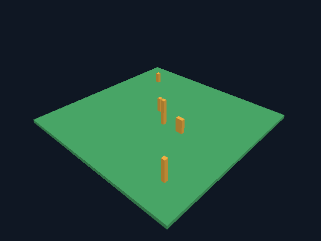

# Этап 0.5: несколько чанков и сохранение

## Проверенное ядро

Владелец мира — фиксированный `world::Map` из девяти чанков, без heap-графа
и отдельного выделения на блок. Чанки (-1..1, -1..1) дают область X/Z
[-16,32), Y [0,16): 48×16×48. Одночанковый диагностический режим сохранён.

В Goose деление `/` отбрасывает дробную часть, но `%` всегда неотрицателен.
Для отрицательных координат используется реальный `std.div_euclid`, проверенный
по pinned reference/stdlib и тестам. Подмена C-подобной арифметикой даёт ошибку
на -1/-17; такие случаи включены в проверки.

Каждый чанк имеет dirty-флаг. Изменение внутри отмечает один чанк; изменение
на стыке — также соседа по грани. На углу отмечаются три чанка, диагональный
не затрагивается. Повторная запись того же ID не меняет revision/dirty.
Очередь ограничена девятью флагами, повторные правки не создают дубликаты.

Мешер получает ограниченный halo 18³ с соседними блоками. Старый reference и
greedy используют одинаковый снимок; внутренние грани на стыках исключаются.
У девяти плоских чанков единая поверхность 4800 единичных граней вместо
5184 у девяти отдельных закрытых плит; greedy выдаёт 30 прямоугольников.
Проверены X/Z стыки и отрицательные координаты, точное покрытие/цвет/ориентация,
движение через границу и коллизия с блоком соседнего чанка.

Добавлен независимый от gfx AABB/frustum-тест для clip space SDL_GPU (Z от 0 до W).
Проверяются видимый, дальний, ближний, задний, граничный и пересекающий камеру AABB.

Сохранение имеет [собственный версионный формат](world-format.md), контрольную
сумму и атомарную запись. Декодирование транзакционное. Это не формат Minecraft.

Полный `python tools/project.py test` прошёл Linux GCC 14.2: шесть suites в
TinyCC/native, release/debug, проверки CLI и независимая проверка сохранённых
байтов через Python/zlib. [Лог](validation/multichunk/headless-linux-gcc14.log).
Тот же набор прошёл в контейнере GCC 12.2, включая отрицательную границу,
столкновения с соседним отрицательным чанком и внешние границы мира:
[лог GCC 12.2](validation/multichunk/headless-linux-gcc12.log).

## Графика и поведение сохранений

Кадр получен настоящим нативным клиентом через Linux software Vulkan.
По умолчанию игрок видит мир от первого лица; выше диагностическая обзорная
камера. Плоская площадка и столбики — собственные данные, не ресурсы Minecraft.

Для GPU выделены девять кешей фиксированного размера; CPU vertex/index scratch
переиспользуется между чанками. У мешей локальные координаты, при рисовании
добавляется transform чанка. Перед первым кадром готовятся все активные меши;
далее обрабатываются максимум два dirty-чанка за кадр. Это лимит количества,
не измеренный миллисекундный бюджет. Очередь использует девять флагов.

Frustum culling использует шесть плоскостей SDL_GPU clip space, Z в [0,W].
Reference-режим сохраняет greedy baseline-проверку, но рисует все активные
чанки. При стандартном взгляде 5 чанков отправлены в GPU, 4 отсечены.
При взгляде от мира основной путь отправляет 0, reference — 9; PNG одинаков.
Это сокращение draw calls в данном сценарии, не замер полного FPS.

| Проверка | Наблюдаемый результат |
| --- | --- |
| Начальный мир | 9 чанков, 2332 блока, 72 greedy-прямоугольника |
| Полезные данные начальных mesh buffers | 6336 байт |
| Запрошенная суммарная mesh capacity | 9984 байт, 18 выделений |
| Две правки внутри центрального чанка | 11 построений всего: стартовые 9 + 2 |
| Две правки на X-стыке | 13 построений: стартовые 9 + 2 чанка × 2 правки |
| Перестроения после seam replay по слотам | [1,1,1,1,3,3,1,1,1] |
| Максимальный X игрока в seam replay | 16.199997 — переход через X=16 |
| Файлы одного/девяти чанков | 4112 / 36880 байт |
| F5, затем штатный выход без новых правок | Одна запись |
| Загрузка без изменения блоков | 0 записей, байты файла неизменны |
| Новый мир в каталоге профиля | Запись при выходе, загрузка в следующем процессе |
| Ошибка пути записи | exit 6, посторонний файл не изменён |

Сохранение по умолчанию берётся из профиля пользователя; replay/preview/
single-chunk временные, пока не указан `--world`. `--no-save` задаёт временную
игру. Временные/сохранённые состояния различимы в HUD. Положение игрока не
сохраняется; при загрузке выбирается свободная высота над стартовой клеткой.

Все 30 сценариев выполнены в pinned graphics-контейнере без сети. Оконные
запуски — настоящие X11/SDL-окна в Xvfb. Seam replay инъецирует обычные события
клавиатуры/мыши, проходит физику, редактирование и GPU; его PNG совпал
между offscreen, window и debug. Полный multi replay имеет одинаковое игровое
состояние с reference. Сохраняется допуск максимум 4 пикселей только на
границе геометрия/фон; реально 2, как на этапе 0.4. HUD должен совпадать точно.
Физические устройства ввода, GPU пользователя и Khronos validation layer не проверены.

Доказательства: [render.log](validation/multichunk/render.log),
[render-results.json](validation/multichunk/render-results.json),
[save-results.json](validation/multichunk/save-results.json),
[pixel-comparisons.json](validation/multichunk/pixel-comparisons.json).

Windows CI для новых исходников будет записан после запуска; успешный run 0.4
не считается их проверкой. Windows GUI и пользовательская Windows 10 пока не
проверены. Мир фиксированного размера, без потоковой загрузки, света,
инвентаря, крафта и сетевого протокола.
