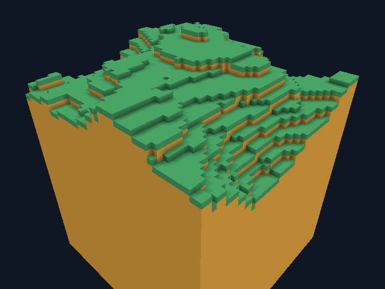

# GooseCraft 0.15 — локальное затенение углов

Добавлен opt-in vertex ambient occlusion целиком на Goose:

```bat
goosecraft.cmd --tall-world Tall.gcw --radius 4 --ambient-occlusion
```

Открытые вершины сохраняют прежнюю яркость грани, соседние блоки затемняют
углы. Сэмплируются две боковые клетки и диагональная снаружи видимой грани;
две боковые заняты — уровень 0, иначе 3 минус число занятых. Множители
яркости [128,166,210,255]/255, применены к прежнему RGB грани с целочисленным
усечением. Альфа 255. Шейдеры, vertex layout 16 байт, C и ресурсы не менялись.



[Сцена со столбами](validation/occlusion/ao-demo.png),
[тот же Tall без AO](validation/occlusion/tall-preview.png).

## Объединение и обновление

Ключ состоит из материала и четырёх 2-bit уровней. Объединяются только
однородные грани с одним ключом. Неоднородные остаются единичными; сохраняется
reference-диагональ, дополнительного выбора диагонали пока нет. Stitch может
делить только однородные крупные прямоугольники, не теряя AO исходных вершин.
После правки обновляются и диагональные секции, чей Halo содержит клетку:
от одной до восьми на XYZ-углу. Бюджет остаётся два remesh за кадр, поэтому
соседние секции могут обновиться через несколько кадров.

Режим выключен по умолчанию. Он использует отдельные 49 152-byte masks;
legacy builder сохраняет 24 576-byte masks и прежнее освещение. Цена AO —
дополнительные выборки и геометрия; преимущества в FPS не заявляются.
GPU capacity/mesh bytes — запрошенные полезные ёмкости, не полный RSS/VRAM.

## Проверки

[Headless Linux GCC 14](validation/occlusion/headless-linux-gcc14.log) и
[pinned Docker GCC 12](validation/occlusion/headless-linux-gcc12.log):
15 suites JIT/native release/debug, два native-only suites release/debug,
CLI и прежние byte vectors прошли. Новый suite проверяет 192 комбинации
ориентации/угла/соседей, известные RGB, каждый угол построенных поверхностей
через независимые координаты и таблицы, отсутствие пропавших/перекрывающихся
единичных граней, сохранение цветов и диагонали после stitch, отсутствие
T-junctions, negative Y и invalidation на границе восьми секций.
Независимый triangle clipper дополнительно проверяет реальные indexed triangles
против прежних единичных граней; неверный меш с удалённым треугольником отвергается.

**168 Vulkan/Xvfb сценариев прошли**, включая 10 AO cases; 159 PNG,
76 profiles, misuse=0. Обзор demo совпал побайтно между release/debug,
окном/offscreen и unit-face AO reference. Совпали window/offscreen Tall
preview и replay правок на шве. Состояние игрока, ticks, break/place,
hotbar и число блоков при AO совпали с прежними Map/Tall/Paged replay;
Tall save bytes совпали с режимом без AO. Сохранённые файлы seam replay
окна/offscreen также одинаковы. Нет новых clear-пикселей в demo и Tall:
изменились 2159 и 40163 пикселя соответственно. Все прежние **149 PNG**
совпали побайтно с baseline 0.14 в этом же software Vulkan окружении.

Первый прогон выявил различие HUD между persistent и temporary seam cases;
условия приведены к persistent с обеих сторон, полный графический прогон
повторён и прошёл. Это не скрытая потеря геометрии. Равенство всех ракурсов
Tall/Paged с GPU unit-face reference не проверялось; CPU coverage доказана
отдельно для тестовых поверхностей, а границы графических проверок указаны выше.

| Сцена | Mesh bytes без AO | С AO | Запрошенная GPU capacity без / с AO |
| --- | ---: | ---: | ---: |
| Demo, один чанк | 9152 | 11752 | 12288 / 16384 |
| Tall, radius 1 | 300568 | 407656 | 452608 / 590848 |
| Paged, 25 GPU-ready чанков, replay | 327960 | 572152 | 503808 / 876544 |

Tall initial_mesh_ns: 2 874 457 без AO и 4 445 793 с AO. Это одно наблюдение
CPU wall time начальной сборки и вызовов загрузки GPU-буферов, не чистый
benchmark мешера, не GPU execution time и не pass/fail-порог производительности.
Условия и raw profiles сохранены, сравнения с Minecraft FPS нет.

[Итог AO](validation/occlusion/occlusion-results.json),
[стоимость и сравнение 149 старых PNG](validation/occlusion/cost-results.json),
[все counters/PNG hashes](validation/occlusion/render-results.json),
[raw profiles](validation/occlusion/profiles),
[независимый пересчёт](validation/occlusion/profiling-results.json),
[graphics log](validation/occlusion/render.log),
[source/binary hashes и окружение](validation/occlusion/provenance.json).
Runtime network=none; Linux x86-64, Mesa lavapipe LLVM 15, Xvfb.

Source `2a9afe97840017f823a506ac5a5979b65360292d` опубликован;
[Actions 41117617172](https://github.com/kokasikhorik-bot/GooseCraft/actions/runs/41117617172)
завершился **success**: все три jobs прошли. Windows release/debug graphical
clients и UTF-8 manifests собраны; 15 JIT/native suites release/debug, два
native-only, CLI/cmd, benchmark и упаковка прошли. Linux CI повторил headless
и 168 graphics cases. [Windows ZIP 0.15](https://github.com/kokasikhorik-bot/GooseCraft/actions/runs/41117617172/artifacts/13006622913),
[полный REST snapshot](validation/github-actions-41117617172.json),
[отчёт CI](github-ci.md). Окно на Windows не открывалось, builder Server 2022.

Отдельно проверена Linux-поставка: UID 1000, cwd `/tmp`, network=none,
root filesystem read-only, исходный `/work` и Goose compiler скрыты tmpfs.
Упакованный native client выполнил 90 кадров inventory/play/edit с AO на Y=35;
PNG и сохранённые GCW v4 bytes совпали с полным набором. Native headless
открыл тот же save; 12 лицензий и оба бинарника совпали с проверенными файлами,
миров и debug binaries в поставке нет. BUILD-INFO 0.15.0 с source `2a9afe9`;
dirty=true относится к добавленным package evidence/docs, source hashes
совпадают с commit. Файлы, скопированные Docker от root, приведены к UID1000
без изменения содержимого. [Итог](validation/occlusion/package-results.json),
[log](validation/occlusion/package/run.log), [кадр](validation/occlusion/package/frame.png).
Это проверка Linux-поставки, Windows ZIP локально ещё не скачивался.

## Границы этапа

Работает с Map, Tall и Paged; полный CPU halo paged backend уже включает
диагональных соседей. AO не меняет блоки, physics, seed, GCW v1/v2/v3/v4 или
содержимое сохранения. Это локальное угловое затемнение, а не распространяемый
skylight/block light, движущиеся источники, текстуры или погодные тени.
Материалов по-прежнему два. Сетевая совместимость с Minecraft ещё не реализована.
Linux software Vulkan не подтверждает работу физического GPU или GUI Windows.
