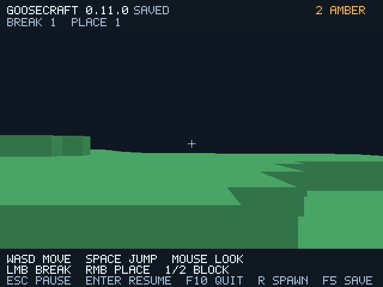

# GooseCraft 0.11 — фоновая подготовка страниц

В `--paged-world DIR` входящие страницы теперь заранее читает/проверяет либо
генерирует **один Goose worker**. На проверенном файловом маршруте main
вызвал чтение страницы **38 раз вместо 48**, worker — 5 раз. Всего 43 вместо
48: подготовленный результат заменяет оба чтения preflight/admission.
Это счётчики конкретного маршрута, не доказанный рост FPS.



```bat
goosecraft.cmd --paged-world BigPages
goosecraft.cmd --paged-world BigPages --sync-paging
```

Второй вызов — диагностический синхронный baseline. GCW v1/v2, каталог v3 и
генератор 1 не менялись. Обычный `--world FILE` не запускает worker.

## Владение, очередь и сохранность

`prefetch.goose` использует настоящий `thread_fn`, проверенный по pinned
reference §22 и thread-tests. Worker — отдельная программа Goose со своими
data stacks. Path и Job/PageIndex передаются flat copy, Result содержит
полностью проверенный Chunk. Ссылок на изменяемый мир, GPU или lock handle
в сообщениях нет. Native C I/O не менялся, нового C-планировщика нет.

Обе typed queues имеют `qlimit(1)`, outstanding job максимум один. Staging
содержит 8 Page, **32968 байт**. Запрос — 1337 байт, ответ — 4137 байт по
фактическому Goose layout. Это payload capacity, не общий heap/RSS. Worker
имеет собственные locals/Path и data stacks с виртуальными резервами;
allocator/OS/driver и возможный запас очереди не измерены. CPU-пул остаётся
49 чанков/200704 байта, staging учитывается отдельно.

Сначала выбирается ближайший край текущего чанка; затем направление
фактического горизонтального движения. Одна ведущая ось даёт не более семи
входящих CPU-страниц. При смене направления неподходящие результаты удаляются.
Готовый результат перед использованием сверяется с текущими slot/generation/
hash/count; результат для уже резидентного или изменённого поколения не
перезаписывает live blocks. Неиспользуемая ошибочная speculative page сама
не останавливает игру; при необходимости её повторно проверяет safe path.

Main по-прежнему владеет mappings, физикой, правками, GPU и commit. Если
подготовка опоздала, используется синхронный read/generate. Неизвестные
данные не становятся воздухом. Атомарная запись и dirty eviction остались
на main. Старые immutable generations не удаляются, пока worker их читает;
внешнее изменение файлов во время сеанса не поддерживается.

При штатном выходе принимается ожидающий Result, затем stop и `thread_wait`.
Это может ждать один I/O. Join измерен отдельно после GPU flush; он не
выдан за GPU time. К моменту отчёта completed=submitted. Нормальный worker
использует обычный thread_spawn; неожиданный abort worker завершает процесс,
неисправленная ошибка диска возвращается как Result.ok=false.

## Проверки

Прежние **12 suites** прошли TinyCC/native release/debug на GCC 14.2 и 12.2.
Новый **native-only prefetch suite** также прошёл release/debug на обоих
компиляторах: пять тёплых admission без main reads, запрет второго outstanding
задания, старый результат после правки/commit, неизменность live model,
плохая страница, fallback, ранний shutdown и три перезапуска.
Первый ID worker 0 учтён, inactive sentinel -1. Отказ TinyCC JIT из-за TLS
проверен отдельным отрицательным probe; JIT-успех потоков не заявляется.

**127 Vulkan/Xvfb сценариев** (прежние 121 и шесть новых), pinned Docker,
network=none, Mesa lavapipe CPU. 118 PNG и 37 профилей: hashes проверены,
percentiles независимо пересчитаны. API misuse=0. Байтные PNG и игровое
состояние совпали с synchronous fallback/Map: обычный и файловый мир,
window/offscreen/debug, задержанный worker. GCW export совпал побайтно.
Ранний выход с ожидающим заданием завершился и сохранил мир.

Число ticks сравнивается строго в fixed-step replay. У real-time idle reopen
пары длительность кадров разная, поэтому точное равенство ticks убрано;
позиция, остальное состояние и PNG всё ещё сравниваются строго. Это устраняет
флак: в одном прогоне было 8 против 7 тиков без различия кадра/позиции.

На файловом мире 680 кадров: пять hits, main file reads 38 против 48,
worker file reads 5. Без искусственных задержек суммарное main preparation
time в одном прогоне **0,6772 против 0,8387 мс**, worker 0,1329 мс параллельно.
Это не время одного кадра. При всех версиях маршрут дошёл до X=69,62551 и
вернулся через R, правки/сохранения совпали.

`--page-delay-ms 2` добавляет искусственную задержку каждой подготовки в
обоих режимах, в том числе на worker через copied scalar global. В этом
контролируемом файловом сценарии main preparation заняла **79,5768 против
100,3867 мс** за весь прогон; это не hardware benchmark. Отдельные 10/50 мс
worker-delay проверяют fallback/ранний выход. Эти flags отмечены в metadata.

[Машиночитаемый итог](validation/prefetch/prefetch-results.json),
[сравнение и raw profiles](validation/prefetch/comparison.md),
[PNG hashes/counters](validation/prefetch/render-results.json),
[provenance](validation/prefetch/provenance.json).

## Что ещё задерживает кадр

Начальная загрузка, опоздавшая подготовка, F5, dirty commit и загрузка после
телепортации остаются синхронными. В сценарии с искусственными 2 мс самый
длинный кадр после R около **81 мс в обоих режимах**. Фоновый worker эту
паузу ещё не устраняет. p99 обычного offscreen файлового прогона также
не улучшился (0,4322 против 0,3765 мс). Общий FPS-прирост не заявляется.

Один software-GPU прогон не определяет устойчивую скорость; worker делит
CPU с lavapipe и требует дополнительной памяти. GPU timestamps, полный
RSS/VRAM, physical GPU и пользовательская Windows 10 GUI не проверены.
Крупный мир/сеть Minecraft пока отсутствуют. Итог Windows native/CLI сборки
публикуется отдельно в [github-ci.md](github-ci.md).
