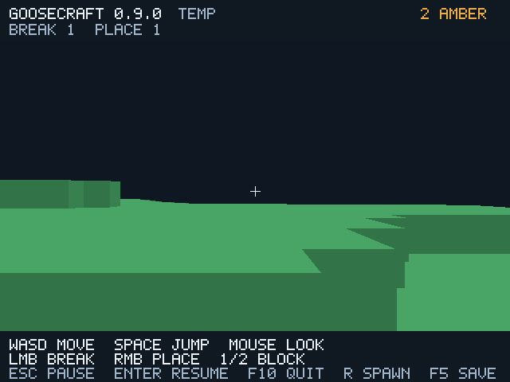

# GooseCraft 0.9 — ограниченная GPU-резидентность

Обычная игра хранит до **25 GPU-мешей** вокруг игрока вместо всех 81.
Начальная запрошенная live ёмкость mesh-буферов seed 12345 уменьшилась
с **1732608 до 503808 байт (−70,92%)**. Все 81 CPU-чанк и GCW v1/v2 сохранены.
Это конечный мир 144×144×16, без paged storage и сетевой совместимости.



## Реализация на Goose

`src/core/residency.goose` не зависит от графики. Состояние хранит wanted/ready
отдельно от наличия треугольников: пустой чанк тоже может быть готовым.
Выбор — квадрат вокруг чанка игрока, обрезанный краями конечного мира.
`--mesh-radius 1..4` задаёт радиус; default обычной игры 2 (максимум 25),
`0` сохраняет весь мир. Preview и прежние replay-режимы сохраняют default 0;
новый `--stream-replay` использует 1, чтобы проверить вытеснение за короткий путь.

Первый набор строится до первого кадра. Потом очередь выбирает ближайший
dirty-чанк: Chebyshev distance, затем Manhattan, затем стабильный slot order.
Бюджет — два построения за кадр. Вышедшие vertex/index буферы освобождаются,
их handles/capacity/геометрия сбрасываются; накопленные uploads/allocations/
rebuilds остаются для профиля. Возвращённый чанк строится заново из актуальных
CPU-блоков и полного halo соседей. Невидимые блоки не заменяются воздухом.

Dirty вне GPU-набора снимается, поскольку геометрии там уже нет. Admission
всегда заново ставит dirty. Это не потеря правки: блоки/revision/сохранение
не зависят от GPU-кеша. Планировщик проверен без SDL/GPU; рендерер использует
его же решения. Массив metadata GPU-кешей пока имеет 81 слот, но буферы
выделяются только для резидентных мешей. CPU-блоки занимают логические
331776 байт и не выгружаются.

Использован существующий `gfx::release(Buffer)`, объявленный в pinned
`gfx.goose:493`, реализация `src/gfx/gfx_resources.c:214` вызывает
`SDL_ReleaseGPUBuffer` и удаляет handle из таблицы. Документация pinned SDL
гарантирует удаление, когда оно безопасно, и запрещает дальнейшее использование
старого handle. Нового FFI/API и зависимостей нет, toolchain pins/лицензии прежние.
SDL/driver может держать retired buffer до завершения GPU-команд: учтённая
live API capacity не является физической VRAM и не ограничивает её пик.

## Проверки

**11 headless suites** прошли TinyCC/native release/debug на GCC 14.2 и 12.2.
Новый suite проходит все 81 положение окна, отрицательные координаты и края,
смену направления до завершения очереди, лимит/приоритет, правку вне набора,
возврат, сохранение/чтение и радиус 0/одночанковую диагностику.
Блоки исходного мира побайтно не меняются от перемещения окна. Четыре прежних
v1 и четыре v2 независимых SHA-256 вектора по-прежнему совпадают.

**111 Vulkan/Xvfb сценариев**: сохранены прежние 98, добавлены 13 проверок кеша.
Получены 103 PNG и 23 профиля; SHA-256 readbacks проверены, все percentile
summary независимо пересчитаны из rows. Тест выполняется в закреплённом Docker
с `--network=none`, Mesa 22.3.6 lavapipe, без физической видеокарты.
API misuse count равен нулю.

Маршрут `--stream-replay`: обычные injected mouse/key events, фиксированный
шаг, один break/place, шесть прыжков, 20,624977 блока пути, X от 31,5 до
52,124977 и R через штатный handler обратно в X=10,5. Пик — 9 резидентных
мешей, 24 admission, 15 eviction, 30 вызовов освобождения непустых буферов,
28 построений с initial 9. После возврата правки остались, очередь пуста.
В режиме хранения всех мешей — 81 admission, 0 eviction и 85 построений.

Диагностический `--retain-meshes` хранит всю геометрию, но рисует тот же
квадрат. Его PNG/игровое состояние совпали с кешем: после обычного перехода,
на дальнем участке (340 кадров), после возврата (400), при F5. Сравниваются
одинаковые видимые данные; уменьшение дальности относительно полного обзора
не выдано за равенство кадров. Window/offscreen/debug итогового маршрута
также совпали. Это сравнение сохранённых кадров, не каждого промежуточного
кадра при догрузке. Headless отдельно проверяет незавершённую очередь.

Два файла после streamed/retained маршрутов совпали побайтно. Повторное
открытие не переписало файл. GCW и генератор не менялись, старые миры не
мигрируют. События F5/ошибок/профилирования и прежние геометрические проверки
остались в общем suite.

## Стоимость и границы

[Таблица одного локального сравнения](validation/residency/comparison.md),
[сырые профили](validation/residency/profiles/),
[счётчики/PNG SHA](validation/residency/render-results.json),
[итог кеша](validation/residency/residency-results.json),
[source hashes и toolchain](validation/residency/provenance.json).

Оба idle-прогона: один и тот же seed/игрок/радиус рисования 2, окно 640×480,
180 кадров, warmup 30, без readback. Полезные mesh bytes 327728 против
1168680, созданий буферов 50 против 162. CPU-блоки одинаковы. Цена кеша —
повторное построение/загрузка при возврате. Один прогон software GPU не
доказывает устойчивый коэффициент FPS; CPU wall включает ожидания driver.
GPU timestamps, общий RSS/VRAM и преимущество над Minecraft не измерены.
В этом idle-прогоне p50 CPU wall не улучшился: 2,0989 мс с кешем против
2,0243 мс с хранением всех мешей. Подтверждён выигрыш в запрошенной live
ёмкости и объёме начальной подготовки; устойчивое ускорение кадров не заявляется.

Видимость обрезается по границам квадратного набора чанков, без fog/LOD.
При переходах и после R недостающая дальняя геометрия догружается по бюджету,
поэтому возможен pop-in. Физика/редактирование используют весь CPU-мир.
Полная CPU-подгрузка потребует страниц с координатами/seed, нового формата и
явного переноса GCW — это следующий отдельный этап, не возможность 0.9.

Все три jobs [GitHub Actions 41073792518](https://github.com/kokasikhorik-bot/GooseCraft/actions/runs/41073792518)
для source `8978d6ad64a2414d71f35c7ec760423d3496588b` завершились success:
Windows native/JIT/CLI, Linux и 111 графических сценариев.
[Windows ZIP 0.9](https://github.com/kokasikhorik-bot/GooseCraft/actions/runs/41073792518/artifacts/12986208060)
создан; метаданные и digest — в [github-ci.md](github-ci.md). Окно Windows 10, физический GPU
и Khronos validation layer пока не проверены. Linux Xvfb этого не заменяет.

Локальная Linux-поставка собрана из проверенных native outputs. Из `/tmp`
выполнены headless `--version` и graphical `--help` без открытия GUI, оба
бинарника совпали с тестовыми; все 12 файлов лицензий совпали побайтно.
BUILD-INFO указывает 0.9.0, source `8978d6a`, GCW [1,2], profiling schema 1.
Сохранений и debug-программ нет. [Проверка состава](validation/residency/package-results.json)
не является проверкой Windows ZIP.

## Запуск

```bat
goosecraft.cmd --world Big.gcw --radius 4
goosecraft.cmd --world Big.gcw --mesh-radius 1
goosecraft.cmd --world Big.gcw --mesh-radius 0
goosecraft.cmd --no-save --profile cache-001.json
```

Размер блокового мира задаёт `--radius`; область геометрии — `--mesh-radius`.
Локальные инструменты сборки пользователю не требуются. Диагностика в облаке:

```sh
goosecraft-client --offscreen --stream-replay --frames 400 --screenshot stream.png
goosecraft-client --offscreen --stream-replay --retain-meshes --frames 400 --screenshot retained.png
```
