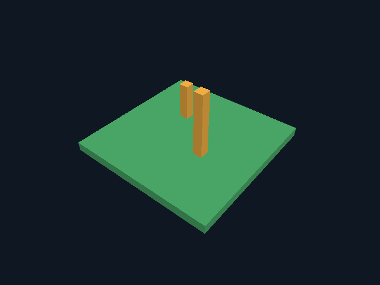

# Этап 2: нативная графика, 2026-10-29

**Проверено реальное выполнение графического клиента в облаке.** Получен
самостоятельный ELF x86-64, построенный Goose из `src/viewer.goose`.
Goose-компилятор и Minecraft/Horizon не участвуют в исполнении этого бинарника.

Это readback текстуры экрана настоящего рендерера, не макет и не изображение,
созданное генеративной моделью. Сцена — собственный плоский чанк и два столбика,
только цвета граней; текстур, шрифтов и Minecraft-ресурсов в кадре нет.

## Проверенное окружение

- Goose `cce94b919d27458856ae2685974049eac78debcf`, runtime `f2981814a754`.
- goose_gfx `6cfa3dec2ef2a6cb19ee71548b38151094e947bd`.
- SDL 3.4.16, commit `fa2c02bb6e21974a89ea9824bc53c9932abe5f9c`.
- Nuklear `9f7750296f176e506c2b24ff55bc24495e2db750` (dependency package,
  UI/font API клиент не использует).
- Python 3.12.14, CMake 3.31.6, GCC 12.2.0, Debian bookworm.
- Mesa 22.3.6, llvmpipe LLVM 15.0.6, Vulkan API 1.3.230, CPU device.
- Xvfb с настоящим SDL X11-окном. Физического GPU/монитора нет.
- Сборка клиента и все графические тесты выполнены с Docker `--network=none`.

## Результаты

| Сценарий | Кадры | Вершины / индексы | Пиксели геометрии | gfx misuse |
| --- | ---: | ---: | ---: | ---: |
| Offscreen, пустая сцена | 3 | 0 / 0 | 0 | 0 |
| Offscreen, voxel-сцена | 3 | 2480 / 3720 | 49857 | 0 |
| X11-окно в Xvfb, та же сцена | 3 | 2480 / 3720 | 49857 | 0 |

Все PNG — 640×480. Offscreen и window PNG совпали побайтно:
`0700e39a7fce92ff408fda50c6d60f5a102ccf30cb1632d4241d997a6b01dc78` (SHA-256).
Пустой кадр имеет другой hash; проверка не принимает простой clear за сцену.
Без DISPLAY оконный запуск с явным X11 вернул exit 3 и `graphics unavailable`,
а не переключился незаметно на headless. Неверный `--frames 0` вернул exit 2
до инициализации GPU. `--help` также отработал без дисплея.

`gfx misuse == 0` относится к проверкам API goose_gfx. Vulkan validation layer
KHRONOS в этом окружении не установлен; полная Vulkan validation не заявляется.
SDL сообщает об отсутствии VK_EXT_headless_surface, но рендеринг в текстуру
через Vulkan успешно выполнен: для этих offscreen-тестов поверхность не нужна.

Чанк содержит 267 собственных тестовых блоков. Мешер оставляет 620 видимых
граней. CPU-тесты отдельно проверили пустой чанк (0 граней), один блок (6),
два соседних (10), слой (576) и полный чанк (1536), валидность индексов,
ненулевую площадь и наружную ориентацию треугольников. Они прошли через
TinyCC/native, release/debug на хосте и в независимом контейнере без gfx/SDL.

## Воспроизведение и доказательства

Команды стандартного чистого окружения приведены в [cloud.md](cloud.md).
Локальная проверка в этой сессии использовала собранный graphics-образ,
Docker volume для повторного использования native CMake build и read-only
bind mounts финальных `src/` и `tools/`. Это позволило избежать повторного
копирования крупных слоёв при Docker storage driver vfs. Исходники зависимостей
в образе закреплены и проверены; native build выполнялся с `--offline`.

- [render.log](validation/stage2/render.log) — настоящий вызов компилятора,
  Vulkan device report, ожидаемые ошибки CLI/дисплея и все три запуска.
- [render-results.json](validation/stage2/render-results.json) — readback-метрики и SHA-256.
- [vulkan.txt](validation/stage2/vulkan.txt) — сведения о CPU Vulkan device.
- [graphics-environment.log](validation/stage2/graphics-environment.log) — сборка
  закреплённого окружения, версии Debian-пакетов и проверка submodule pins.
- [headless.log](validation/stage2/headless.log) и
  [headless-container.log](validation/stage2/headless-container.log) — проверки ядра/мешера
  на GCC 14.2 и GCC 12.2, без подключения графического пакета.
- [core-mesh-gcc12.log](validation/stage2/core-mesh-gcc12.log) — финальная усиленная
  проверка каждого индексированного треугольника через TinyCC/native, release/debug.
- [package.log](validation/stage2/package.log) — упаковка обоих Linux-бинарников,
  `--help` графического клиента и запуск headless-клиента из поставки.

Во время настройки выявлены и исправлены отсутствующий XTEST development
package (`libxtst-dev`) и доступ непривилегированного apt к public CA mount.
Кеши старых Docker-образов заполнили диск; удалены только созданные этой задачей
производные образы/кеши. Исходники и Git не удалялись. Старые `extern "symbol" fn`
в pinned gfx дают deprecation warnings; upstream не изменялся.

## Что дальше

Windows workflow обновлён: графический и headless бинарники, лаунчер и лицензии
упаковываются автоматически; Linux job повторяет software Vulkan/Xvfb smoke.
На момент графического этапа GitHub Actions ещё не запускался. Позднее репозиторий
создан и код опубликован. После первого приватного отказа и исправления Windows
Python pin публичный CI успешно прошёл Windows x64 и Linux ([отчёт](github-ci.md)).
Пользовательская Windows 10, Direct3D 12,
физический GPU, клавиатурное управление и интерактивная игра не проверены.

Это исторический отчёт графической основы 0.2. Управление, коллизии и изменение
блоков реализованы на [этапе 3](stage-3-results.md); его результаты и границы
проверки записаны отдельно.
