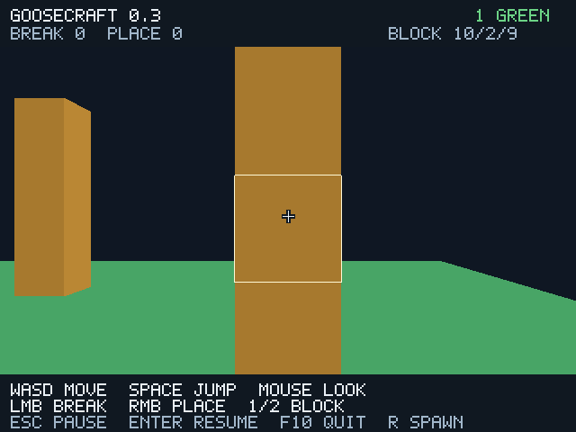

# Этап 3: первый игровой цикл

## Проверенное ядро — 2026-10-30

Добавлены `core/player.goose` и `core/interaction.goose`, без зависимости от gfx.
Физика использует фиксированный шаг 1/120 секунды, гравитацию, прыжок,
нормализованное движение WASD и разрешение AABB-коллизий по осям. Скорость
падения ограничена, поэтому перемещение за шаг меньше блока. Края чанка
ограничивают горизонтальное движение; падение в отверстие возвращает игрока
на старт, с проверкой свободного пространства после редактирования мира.

Выбор блока — DDA-обход сетки с расстоянием в мировых единицах и нормалью
попавшей под луч грани. Установка отказывается менять занятую клетку,
выходить за чанк и пересекаться с телом игрока. Это собственные правила
прототипа, не заявление об эквивалентности физике Minecraft Java Edition.

`python tools/project.py test` прошёл на Linux x64/GCC 14.2: прежние проверки,
новые физика/луч/редактирование в TinyCC и самостоятельных native-бинарниках,
в release и debug. Проверены падение, приземление, прыжок, потолок, скольжение
вдоль стены, отсутствие ускорения по диагонали, границы, возрождение, шесть
направлений луча, дальность, точное попадание на границу клетки, запрет
установки в игрока и изменение геометрии после редактирования.
Дополнительный сценарий выполняет 8000 физических шагов среди препятствий,
меняя направление и прыгая; после каждого шага проверяет отсутствие
пересечения с блоками и выходов за горизонтальные границы.

Логи: [GCC 14.2](validation/stage3/headless-linux-gcc14.log),
[GCC 12.2 в контейнере](validation/stage3/headless-linux-gcc12.log).

## Графика и полный игровой цикл

Обычный запуск теперь открывает игру от первого лица. Добавлены мышь/WASD,
стрелки как запасной обзор, прыжок, прицел и обводка цели, два материала,
удаление и установка по клику. После изменения мира старые GPU-буферы
освобождаются, CPU-меш пересчитывается и загружается заново. HUD содержит
подсказки и счётчики; его bitmap-алфавит задан собственной геометрией в Goose,
внешние шрифты не используются. Оригинальные Minecraft-ресурсы не добавлялись.

Escape освобождает мышь и останавливает физику. Потеря фокуса также ставит
игру на паузу и сбрасывает накопленный шаг/прыжок. Enter/клик продолжает;
клик продолжения не редактирует мир. F10 выходит, R возвращает на старт.
Полное [управление и первый запуск](first-play.md).

Pinned gfx API проверен по исходникам: `key_down`, `key_pressed`, `mouse_delta`,
`mouse_pressed`, `set_mouse_relative`, `focused`, `delta_time`, `update_buffer`,
`release`, `inject_key`, `inject_mouse`, `inject_focus`. Сторонний C/C++ код
игровых правил не добавлялся; никаких придуманных API нет.

На том же закреплённом Linux graphics-окружении этапа 2 выполнены десять
сценариев с Docker `--network=none`: пустая сцена, обзорный offscreen/оконный
кадр, обычное игровое окно, кадры до/после удаления блока, пауза и полный
input replay в offscreen, X11/Xvfb и debug native-бинарнике.

Replay подаёт события через настоящий SDL/gfx input API; далее они проходят
обычные обработчики игры. Для воспроизводимости только время задаётся как
1/60 секунды на кадр. Это автоматическая инъекция ввода, не ручная проверка
физической клавиатуры/мыши. В обычной игре используется реальный delta_time,
ограниченный 0.1 секунды на кадр, и фиксированные физические шаги 1/120 секунды.

| Проверка полного replay | Результат |
| --- | --- |
| Кадры / шаги физики | 110 / 192 |
| Прыжки / ручное возрождение | 1 / 1 |
| Удалено / установлено | 1 / 1 |
| Перестроений меша, включая начальное | 3 |
| Блоки до / после полного сценария | 267 / 267 |
| Пройденное расстояние | 2.619998 |
| Максимальная высота ног | 2.195834 |
| Пауза / потеря фокуса / продолжения | 14 кадров / 1 / 3 |
| Конечная позиция | 10.5, 1.0, 13.5 |
| gfx misuse | 0 во всех десяти сценариях |

Удаление изменило индексы 3720 → 3708 и число окрашенных пикселей
194996 → 184775 при той же камере. После установки — 3732 индекса.
Оконный, offscreen и debug replay дали одинаковое состояние и побайтно
одинаковый финальный PNG, SHA-256:
`611c9327ec0ed3d6a5f7de4a18f0b4a9ee46caf568b234b0a0693c892fab4872`.
Прежний обзорный кадр также сохранил hash этапа 2.

Доказательства: [render.log](validation/stage3/render.log),
[render-results.json](validation/stage3/render-results.json),
[кадр после удаления](validation/stage3/replay-broken.png),
[пауза](validation/stage3/replay-paused.png),
[финальный кадр](validation/stage3/replay-window.png).
Проверки API gfx не заменяют Vulkan validation layer, который не установлен.

## Платформы и ограничения

Windows workflow теперь собирает release и debug графического клиента,
выполняет headless physics/interaction suite и существующий cmd.exe smoke.
Результат нового запуска CI будет записан отдельно после его выполнения.
Успешный CI предыдущего этапа не считается проверкой новых исходников.

Окно на Windows, Direct3D 12 и пользовательская Windows 10 ещё не проверены.
Первый пользовательский тест теперь имеет смысл после получения новой
Windows-сборки. Мир временный, один чанк; нет сохранения, сети, инвентаря,
крафта, загрузки Minecraft-миров и заявления о совместимости с Java Edition.
