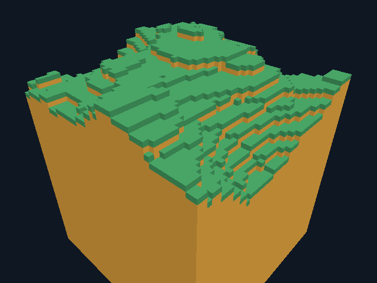

# GooseCraft 0.14 — четыре вертикальные секции

Реализован отдельный нативный backend высотой **64 блока, Y −16..47**:

```bat
goosecraft.cmd --tall-world Tall.gcw --radius 4
```

До 81 колонки/324 секций 16³, 144×144 по X/Z. Новый integer generator 2
поднимает рельеф выше прежнего потолка, поддержаны отрицательные Y, коллизии,
raycast, place/remove, вертикальные Halo/dirty и GPU origin. Обычные режимы
сохранили высоту 16, прежние файлы и generator 1. [Формат v4 и явный перенос](tall-world-format.md).



Новый мир полностью резидентный. Это функциональный шаг к высокой модели,
а не вертикальный paging, бесконечный мир или поддержка Minecraft Anvil/серверов.
При повторном открытии `--tall-world` загружает сохранённые блоки. Перенос
`--headless --import-tall Old.gcw New.gcw` сохраняет старую область Y 0..15,
заполняет новые уровни воздухом и не меняет исходник. Неизвестный seed не
выдумывается: migrated generator/seed 0/0. Перенос v3 — через прежний GCW export.

## Что проверено

**14 suites** прошли TinyCC/native release/debug на GCC 14.2 и pinned Docker
GCC 12.2; два native-only worker suites и TLS JIT rejection также прошли.
Новый tall suite проверяет координаты −16/−1/0/15/16/31/32/47, недопустимые
Y, vertical dirty и Halo, отсутствие внутренней грани между секциями,
падение/приземление на Y=21 и Y=−9, raycast/place выше 16. Проверяются v4
roundtrip, невалидные header/count/range/reserved/IDs с верным checksum,
сохранение live model при отказе и миграция всех 81 колонок старого GCW v2.

Пять фиксированных v2 vectors (seed 0/1/12345/4294967295, радиусы 0/1/2/4)
проверены побайтно против независимого Python oracle в JIT и native.
Максимальный vector: 324 секции, 935241 solid blocks, **1327152 байта файла**,
SHA-256 `1b4a7f26bab32706ba162c6425f0f968ed3e68af6bfb8df5defe4abedcf3a7df`.
Generator 1 по-прежнему проходит прежние SHA-256 vectors. CLI проверяет
source-preserving import, отказ перезаписи, wrong-mode load и malformed/1 GiB
файл без неограниченного чтения. Старые source/destination hashes сохранены.

**158 Vulkan/Xvfb сценариев** прошли, network=none, Mesa lavapipe CPU:
прежние 149 плюс девять tall cases. 149 PNG и 66 профилей; misuse=0,
summary независимо пересчитаны. Проверены radius 1/4 overview, release/debug,
window/offscreen, игра/edit/inventory на высоте, миграция против старого Map
на том же input, save/reopen и отказы неправильного режима/diagnostic paths.

| Сценарий | Наблюдение |
| --- | --- |
| tall-preview / window / debug | 36 CPU/GPU-ready секций, PNG равны |
| tall-large | 324 CPU sections, block payload 1327104 bytes |
| tall-play / window | player Y=35, 1 break, 1 place; PNG и gameplay равны |
| tall-migrated / legacy control | player Y=9, exact PNG/ticks/gameplay, слой Y 0..15 после правок совпал побайтно |
| tall-reopen / wrong-mode load | сохранение не переписано, неверный формат даёт 5 и сохраняет байты |

Новые tall cases разрешают полностью заполненный цветом framebuffer при взгляде
на высокий рельеф; nonempty indices и независимые equality checks сохранены.
Равенство с unit-face reference renderer для всех новых ракурсов не заявляется;
mesh/stitch алгоритмы прежние, проверены вертикальные data seams и old suites.

[Итог](validation/tall/tall-results.json),
[PNG hashes/counters](validation/tall/render-results.json),
[игровой кадр](validation/tall/tall-play.png),
[headless GCC 14](validation/tall/headless-linux-gcc14.log),
[GCC 12](validation/tall/headless-linux-gcc12.log),
[graphics log](validation/tall/render.log),
[vectors](../tests/fixtures/tall-vectors.json),
[provenance](validation/tall/provenance.json).

## Цена и границы этапа

Block payload в четыре раза больше старого full Map того же радиуса:
до **1327104 байт**; load/encode scratch, allocator, meshes и driver считаются
отдельно. Это не полный RSS/VRAM. При GPU mesh radius 2 допускаются до 100
ready sections, некоторые без buffers из-за отсутствия видимых граней;
rebuild после startup по-прежнему ограничен двумя секциями за кадр.
Renderer ready/wanted массивы расширены 81→324 для всех modes; старые CPU
Map/Paged payload и очередь/кеш v3 не увеличивались.

Вся модель, генератор, формат, перенос, physics и policy — Goose. В C изменён
только общий bounded-read ceiling 1→2 MiB; read_exact остаётся 16 KiB.
Новых extern API/зависимостей/ресурсов Minecraft нет. Лицензии сохранены.
Мир не претендует на современную высоту Minecraft 384; вертикальный paging,
sparse sections и более высокая модель ещё впереди. Следующая видимая цель —
оригинальные текстуры/освещение. Windows GUI, физический GPU и FPS-преимущество
не проверены. Windows delivery отслеживается в [отчёте CI](github-ci.md).

Все три jobs [Actions 41109972918](https://github.com/kokasikhorik-bot/GooseCraft/actions/runs/41109972918)
для source `b8aa83b09f128a4b122b27071a477ba0f36ea99a` завершились **success**:
Windows/Ubuntu native/JIT/CLI, 14 suites и два native-only, Linux graphics
158 сценариев. [Windows ZIP 0.14](https://github.com/kokasikhorik-bot/GooseCraft/actions/runs/41109972918/artifacts/13002104394)
создан. Окно на Windows не открывалось; builder — Windows Server 2022.

Дополнительная Linux-поставка запущена как UID 1000 из `/tmp`, network=none,
root filesystem read-only, исходный `/work`/Goose compiler скрыты tmpfs.
Упакованные headless/client создали v4 и выполнили 90 кадров play/edit/inventory
на Y=35; PNG и итоговые save bytes совпали с основным suite. Native inspection
не изменил SHA-256. Из старого GCW v2 перенесены все 81 колонки/324 секции;
independent parser подтвердил точное сохранение Y 0..15 и нулевые новые слои,
исходник сохранил SHA-256. Бинарники совпали с тестовыми, 12 лицензий сохранены
побайтно, миров/debug binaries в поставке нет. Локальный владелец каталога
приведён к UID 1000 без изменения содержимого. BUILD-INFO: 0.14.0, source
`b8aa83b`, formats [1,2,3,4]. Это Linux-проверка, не скачанный Windows ZIP.
[Итог](validation/tall/package-results.json), [кадр](validation/tall/package/frame.png).
