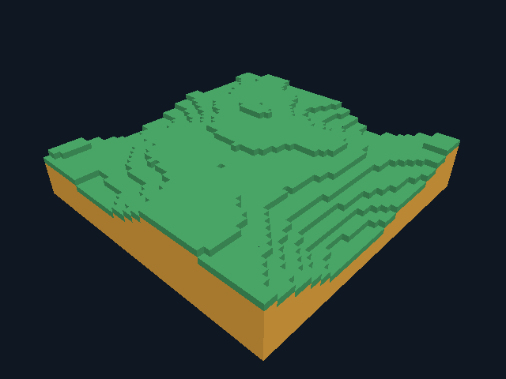

# GooseCraft 0.6 — воспроизводимый рельеф

Новые миры создаются генератором на Goose: зелёная поверхность, янтарная
толща, ступенчатые холмы. Мир по-прежнему ограничен девятью чанками
48×16×48; бесконечная генерация, деревья, вода и сеть пока отсутствуют.



## Генератор и сохранения

`src/core/terrain.goose` — генератор v1. Два слоя value noise с сеткой 16 и 8,
целочисленная smoothstep-интерполяция Q8 и u32 hash дают высоты 3..11.
Seed — целое 0..4294967295, по умолчанию 12345. Нет float-шума, глобального
RNG или зависимости от порядка генерации чанков. Координаты абсолютные,
для отрицательных применяется `std.div_euclid`. Чанк заполняется напрямую,
один расчёт высоты на колонку, без аллокаций на блок и без тысяч dirty-событий.

Беззнаковое переполнение и усечение `as!` проверены по закреплённой
документации Goose `docs/reference.md`, раздел об integer types. Новых
непроверенных библиотечных API, зависимостей и ресурсов Minecraft нет.

Обычный запуск создаёт рельеф, если сохранения ещё нет. Существующий GCW v1
загружается полностью и не генерируется заново; сохранения 0.5 поддерживаются.
Seed не записан в GCW v1: там уже есть все блоки и правки. Лог клиента
выдаёт `terrain_seed=-1`/`terrain_generator=0`, если генерации не было.
Указывать seed для существующего файла запрещено (exit 2 до GPU).

```bat
goosecraft.cmd --no-save --seed 1
goosecraft.cmd --world "D:\Games\Hills.gcw" --seed 12345
goosecraft.cmd --world "D:\Games\Hills.gcw"
goosecraft.cmd --headless --generate-world 12345 "D:\Games\Headless Hills.gcw"
```

Вторая и четвёртая команды предполагают новый путь. Последняя создаёт мир
тем же Goose-кодом без графики и отказывается заменять существующий путь.
`--demo-world` оставляет старую сцену с площадкой и столбиками для диагностики.

## Реальные проверки в облаке

Семь headless suites проходят в TinyCC JIT и native AOT, release и debug.
Новый suite проверяет обратный порядок генерации чанков, границы высот,
отрицательные координаты, поверхность на всех стыках, отсутствие внутренних
граней, точное покрытие/цвета/winding greedy и reference, приземление на обеих
сторонах границ и roundtrip GCW. Все проверки без DISPLAY/SDL/GPU.

Python с arbitrary-precision integer и явными 32-битными масками независимо
рассчитал фиксированные векторы `tests/fixtures/terrain-v1.json`. Тест сравнивает
полные сохранённые файлы JIT/native с ними, а не только число блоков:

| Seed | Блоков | Высоты в этом мире | SHA-256 GCW v1 |
| ---: | ---: | --- | --- |
| 0 | 14109 | 4..9 | `c93b946ca2119dfedc1082beedf7f4b5dfa9fba2c18be7b380f164743f8e1571` |
| 1 | 16243 | 3..11 | `04758846aea2a21e3d9cb258abd81e78808922004d47f65677d2b7c8110f25ef` |
| 12345 | 19196 | 4..11 | `47d0b6beb7cd75c537c6e77abd6f16df04f7a75f5ae2ce32c3903471921d6a70` |
| 4294967295 | 16387 | 3..10 | `3c7feba3c2143cce118d772e9355307679b76a390da80cc31e687155e0ed3ffa` |

40 графических сценариев выполнены в закреплённом Docker без сети, Mesa
lavapipe и X11/Xvfb. Сохранились прежние 30 проверок плоской сцены, добавлены
новые seed, обзор, release/debug, window/offscreen, ходьба по рельефу,
редактирование, прыжки, сохранение и повторное открытие. Default profile
из обычного GUI-процесса совпадает с headless SHA-256 seed 12345.

`--terrain-replay` отправляет настоящие gfx input events через общий игровой
цикл: удалён и поставлен один блок, два прыжка, пройдено около 5.95 блока,
X достиг 16.45 (переход чанка), игрок приземлился на Y=9 без respawn/коллизии.
PNG оптимизированного renderer совпадают побайтно между window/offscreen и
release/debug. Это искусственный ввод, не проверка физических устройств.

У рельефа seed 12345 начальный greedy-меш содержит 817 прямоугольников,
71 896 полезных vertex/index байт; reference — 6 698 и 589 424 байта.
Это объём геометрии, не общий расход RAM/VRAM и не сравнение FPS с Minecraft.

## Известное различие GPU

Обзор greedy и reference **не признан эквивалентным по пикселям**:
на lavapipe отличаются шесть пикселей. Три меняют цвет соседних граней,
один находится на силуэте; в двух местах, (433,160) и (327,312), greedy даёт
одиночный clear-пиксель внутри поверхности, которого нет в reference.
Подозреваются T-стыки при растеризации больших прямоугольников. Причина ещё
не подтверждена и дефект не исправлен. Точное CPU-покрытие поверхности есть;
оно не гарантирует отсутствия таких GPU-просветов.

Сырые различия сохранены в `validation/terrain/terrain-reference-differences.json`
с `equivalence_verified=false`, оба PNG доступны рядом. Прежний строгий
pixel-check плоских сцен не ослаблен. Устранение просветов и измерение цены
исправления — следующий этап рендерера.

Логи/JSON/PNG: [evidence](validation/terrain/). Окно запускалось на Linux/Xvfb
с CPU Vulkan, не на Windows 10 или физическом GPU. Итог Windows CI отдельно
фиксируется в [github-ci.md](github-ci.md); успешная компиляция и CLI не
считаются проверкой окна Windows.
