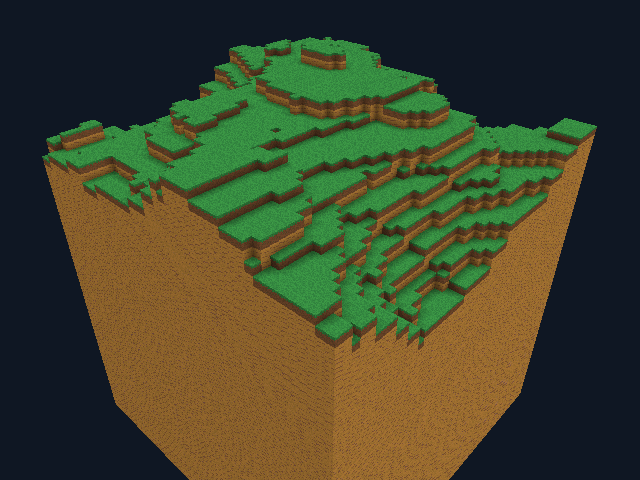

# GooseCraft 0.16 — оригинальные повторяемые текстуры

Opt-in `--textures` включает четыре оригинальных рисунка 16×16: grass-top,
grass-side, earth и ochre. Два прежних материала остаются теми же: у первого
различаются верх/бок/низ, второй использует ochre на всех сторонах.

```bat
goosecraft.cmd --tall-world Tall.gcw --radius 4 --textures --ambient-occlusion
```

Пиксели и выбор рисунка — Goose, texture files не требуются. Minecraft-ресурсы
не использовались. Shader только проецирует UV, выбирает texel из массива и
умножает на neutral face/AO light. Режим действует на изображение, не GCW data.



[Демонстрационная сцена](validation/textures/texture-demo.png),
[тот же рельеф без текстур](validation/textures/ao-tall.png).

## Геометрия и стоимость

UV в единицах блока, period=1. Крупный greedy-прямоугольник повторяет рисунок
на каждой клетке, не растягивает. Столбики metadata axis/layer постоянны на
грани; выбор tile зависит от material/face, уже учитываемых объединением.
AO сохраняет прежние ограничения. Generic stitch копирует metadata, UV
вычисляется из позиции для исходных и новых edge/fan vertices.

Texture vertex 20 bytes (float3, RGBA light, axis/layer/reserved), legacy 16.
Atlas payload 4096 bytes, один mip, nearest/repeat. Это полезные bytes,
не полный RSS/VRAM. CPU rebuild держит одновременно исходные 16-byte quads
и converted 20-byte vertices, что тоже требует памяти. Количество triangles
не увеличивается от одного включения textures, но AO по-прежнему может его
увеличивать. Нет заявления об ускорении или преимуществе FPS над Minecraft.

## Проверки

Новый headless suite проверяет каждый tile на всех unit cells объединённых
прямоугольников, neutral light, vertex layout, сохранение позиции/цвета/metadata
после stitch, affine UV на fan vertices, negative coordinates/section phase,
indexed-triangle coverage и отсутствие T-junctions. Данные рисунков сравниваются
с independent Python oracle и [фиксированными SHA-256](../tests/fixtures/texture-vectors.json).
Golden всего массива: `fddc28c00e91e330a5f154fa2bc3024403d7878d229cefdc62f5c590c09d0b74`.

Отдельный native GPU probe использует **production materials pipeline**.
На кадре 640×480 quad размером 2×2 блока, каждая texture cell занимает 20×15
пикселей. Pixel centers строго внутри texels. Independent reader сравнивает
все RGBA с известным исходным рисунком: все 4 layers × 3 UV axes, координаты
сдвинуты на −16. Первый release probe прошёл 3 686 400 pixel checks, mismatch=0.

**16 suites JIT/native release/debug** прошли на GCC 14.2 и pinned Docker GCC 12.2,
вместе с двумя native-only worker suites release/debug, CLI и прежними byte
vectors/форматами/миграцией. Raw tile bytes во всех четырёх режимах совпали
с independent oracle и golden. [GCC 14 log](validation/textures/headless-linux-gcc14.log),
[GCC 12](validation/textures/headless-linux-gcc12.log).

**182 игровых Vulkan/Xvfb сценария прошли**, 173 game PNG и 90 profiles,
misuse=0. Включают 14 новых texture cases: demo/reference/window/debug,
Tall с/без AO и window/debug, play/edit/inventory на Y35, seam edit и
paged traversal с CPU eviction/reload против full Map при том же input.
Window/offscreen/debug PNG совпали в проверенных парах, Paged/Map traversal
PNG и экспорт GCW совпали побайтно. Текстурный режим не поменял ticks, physics,
break/place, hotbar или Tall save bytes. Все прежние **159 PNG** совпали
побайтно с baseline 0.15 в том же software Vulkan окружении.

Release и debug shared-pipeline GPU probes прошли **24 кадра / 7 372 800
точных pixel checks**, mismatch=0: 4 layers × 3 axes × 2 builds, UV в
отрицательной области. Эти 24 PNG лежат отдельно от game PNG. На перспективном
demo-обзоре greedy и unit-face texture reference различаются в одном пикселе;
точное равенство всех игровых ракурсов с GPU reference не заявляется.
Byte/UV/metadata и indexed geometry проверены отдельно без GPU, а probe
проверяет shader/sampler/upload с точной ортогональной проекцией.

| Сцена | Mesh bytes без / с textures | GPU mesh capacity без / с textures |
| --- | ---: | ---: |
| Demo | 9152 / 10516 | 12288 / 12288 |
| Tall radius 1 | 300568 / 347936 | 452608 / 491520 |
| Tall radius 1 с AO | 407656 / 475196 | 590848 / 664576 |

Число vertices/indices в этих парах одинаково. Дополнительно 4096 texture
payload bytes; это не полная GPU allocation. Initial mesh wall time в одном
прогоне Tall 3 300 157 / 3 241 691 ns, с AO 4 444 765 / 3 936 313 ns.
Время включает build/conversion/upload calls и шум измерения; данные не
доказывают ускорение, GPU time или FPS. Алгоритм не сравнивался с Minecraft.

Первый полный прогон остановился на неверном имени команды экспорта в Python
harness (`--export-world` вместо существующего `--export-pages`). Это исправлено,
полный graphics прогон повторён и прошёл; игровой код между прогонами не менялся.
[Исходный build/первый прогон](validation/textures/render-build-and-first-run.log),
[итоговый log](validation/textures/render.log),
[all results](validation/textures/render-results.json),
[texture assertions](validation/textures/texture-results.json),
[точные GPU probes](validation/textures/texture-probe-results.json),
[стоимость/reference diff/baseline](validation/textures/cost-results.json),
[raw profiles](validation/textures/profiles),
[independent summary checks](validation/textures/profiling-results.json),
[source/binary hashes и окружение](validation/textures/provenance.json).
Runtime network=none; Linux x86-64, Mesa lavapipe LLVM15, Xvfb.
[Архитектура](architecture.md).

Windows Actions будет запущен после публикации source commit. Итоговый ZIP
и REST snapshot добавляются после завершения CI.

## Границы

Материалов по-прежнему два; иконки инвентаря прежние, цветные. Нет внешних
resource packs, прозрачности, mipmaps, анизотропии, случайного поворота tiles,
распространяемого skylight/block light. На расстоянии nearest/one mip может
мерцать/алиасить. Сохранения и генераторы прежние, сервера Minecraft пока
не поддерживаются. Linux/lavapipe не подтверждает GUI Windows или физический GPU.
