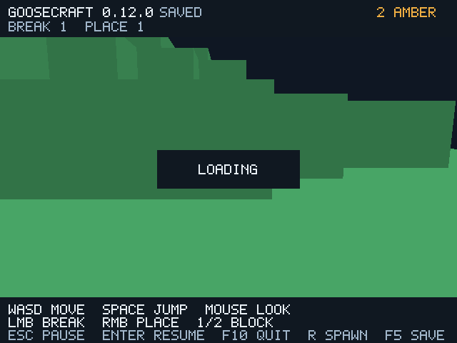

# GooseCraft 0.12 — возврат по R с подготовкой между кадрами

Добавлен отдельный режим:

```bat
goosecraft.cmd --paged-world BigPages --deferred-respawn
```

Во время подготовки области R окно продолжает рисовать прежнюю сцену/камеру
с `LOADING`. Физика и редактирование ждут полностью готовых CPU-страниц.
После подготовки игрок возвращается на старт. Escape/focus и штатный выход
продолжают обрабатываться. Режим **не включён по умолчанию**: суммарное ожидание
может быть дольше обычного возврата, особенно при быстрых локальных файлах.
Ходьба, автоматический respawn, startup и save/commit пока используют прежний путь.



Это не изменение форматов: GCW v1/v2, каталог v3 и генератор 1 сохранены.
Новые зависимости и код C не добавлялись. Политика перехода — Goose.

## Подготовка, владение и отказ

Используются прежние один native Goose worker, queue limit 1 и staging 8 страниц
(32976 байт payload). `transfer::pump` делает один `qpoll`, отправляет максимум
один Job и принимает максимум два Chunk за вызов. Page I/O выполняется worker;
main сохраняет владение mapping, live blocks, GPU и записью изменений.

1. Вычислить целевую область и проверить подписи уже подготовленных страниц.
2. Проверить worker **все** missing pages до eviction. Первые восемь результатов
   остаются в staging; остальные сохраняют только отметку успешной проверки.
3. На main опубликовать dirty commit при необходимости, затем вытеснить старые
   слоты. Инвалидировать center fast path, пока область неполная.
4. Принять готовые страницы с бюджетом два за кадр. Не удержанные в staging
   страницы повторно читает/проверяет worker. Slot/generation/hash/count сверяются.
5. Только после всех admissions опубликовать center/radius и разрешить симуляцию.

Основной поток не вызывает `qget`/`read_page` в pump. Он по-прежнему может ждать
**запись commit**, поэтому строгого предела времени кадра на произвольном диске
нет. Во время loading выполняется pacing `sleep_ms(1)`, чтобы offscreen не
крутился без паузы; точность Windows sleep 1 мс не гарантируется. Новая metadata
перехода содержит только координаты, flags/счётчики и два bool[81], без второго
пула Chunk. CPU block pool остаётся 49 слотов/200704 байта; полного RSS это не измеряет.

Stale speculative result, который предшествовал запросу R, отбрасывается и
запрашивается заново. Ошибка demanded preflight/commit останавливает переход
до изменения пула. Ошибка повторного чтения после eviction — fail closed:
физика/меши не используют неполную область, клиент пытается сохранить pending
checkpoint и выходит с кодом 8. Dirty eviction выполнялась после commit.
При раннем выходе worker дренируется и join завершается; следующий запуск
читает сохранённый индекс. Внешняя правка файлов во время сеанса не поддерживается.

## Проверки

Прежние 12 suites прошли TinyCC/native release/debug на GCC 14.2 и GCC 12.2.
Native-only suites теперь два: prefetch и transfer, release/debug; отказ TinyCC
из-за TLS проверен отдельно для обоих. Новый suite проверяет:

- 19 incoming, полную preflight-проверку и admission с бюджетом два;
- отсутствие изменений live model во время preflight и сохранность dirty eviction;
- повторный переход и запоздавший результат другого поколения;
- повреждённую demanded page, отказ commit и ошибку повторного чтения после eviction;
- отмену при частичном admission, инвалидированный center и корректное восстановление;
- сохранение/повторное открытие и shutdown worker без оставшихся сообщений.

**139 сценариев Vulkan/Xvfb** прошли в pinned Docker, network=none,
Linux Mesa/lavapipe CPU: прежние 128 плюс пять пар deferred/control и ранний
выход. 130 PNG и 49 профилей; misuse=0. Пары проверяют window/offscreen/debug,
искусственные 2 мс page delay и 10 мс worker delay. Во всех завершённых парах
PNG, fixed-step gameplay, ticks, chunk rebuild counts и GCW export совпали.
Во время waiting samples remesh=0; admission максимум два; worker joined.

Во время loading input replay стоит: `logical_frames=frames-loading_frames`.
Control выполняется с тем же количеством logical frames, и **тики сравниваются
строго**, а не исключаются из проверки. Настоящие rendered frames и raw samples
не скрываются; `--frames N` по-прежнему считает кадры окна. Длинные профили
содержат ring overwrite: суммы retained samples нельзя сравнивать со всеми
накопленными uploads/remesh. В harness добавлено это условие; независимый
пересчёт summary и проверки ring сохраняются.

[Headless GCC 14](validation/transfer/headless-linux-gcc14.log),
[GCC 12](validation/transfer/headless-linux-gcc12.log),
[graphics log](validation/transfer/render.log),
[PNG hashes и counters](validation/transfer/render-results.json),
[итог переходов](validation/transfer/transfer-results.json),
[provenance](validation/transfer/provenance.json).

## Измерения и цена ожидания

В завершённом обычном файловом route: 1100 настоящих кадров, **33 loading**,
1067 logical, 19 incoming, 19 validated/admitted, 30 demanded worker requests
(19 preflight + 11 re-read), максимум два admissions за кадр. Ещё пять страниц
подготовлены прежним predictor во время движения: всего 35 worker reads,
**0 main page reads** в игровом цикле. Startup/import/export сюда не входят.
Uncached control выполняет 48 main preparations; прежний cached режим без
deferred R — 30 main + 5 worker. Это счётчики helper, не kernel syscalls.

В одном Linux/lavapipe прогоне с искусственными **2 мс на page preparation**:

| Измерение | Cached blocking R | Deferred R |
| --- | ---: | ---: |
| Wall кадра запроса R | 64,8597 мс | 2,4372 мс |
| Самый длинный кадр от запроса до завершения | 64,8597 мс | 2,4992 мс |
| Сумма записанного wall от запроса до завершения | 64,8597 мс | 77,2272 мс |

Blocking data — `prefetch-latency`, deferred — `transfer-latency`: тот же импорт,
input до R и GPU backend, текущая версия в обоих режимах. Во втором случае
это 33 loading frames плюс completion frame; сумма samples не является полным
end-to-end wall: между samples есть collector/loop overhead. Исходные rows
сохранены, числового performance threshold в CI нет.

Без искусственной задержки ожидание deferred R в записанных samples около
89,7 мс за 34 кадра; это **хуже времени доставки игрока** на быстром файле,
зато обработка окна/рисование продолжаются. В сценарии worker-delay 10 мс
потребовалось 123 loading frames; обычная ходьба ещё использовала main fallback.
Ранний выход после десяти loading frames сохранил правки и завершил worker.

Новый режим уменьшает одну длинную паузу подготовки, не сокращает общий I/O
против 0.11.1 и не доказывает рост обычного FPS. Нет GPU timestamps, проверки
физического GPU, Windows 10 GUI или превосходства над Minecraft. Сеть Minecraft,
полная высота/освещение/инвентарь ещё впереди; [приоритеты и оценка сроков](roadmap.md).
Windows delivery отслеживается в [отчёте CI](github-ci.md).
